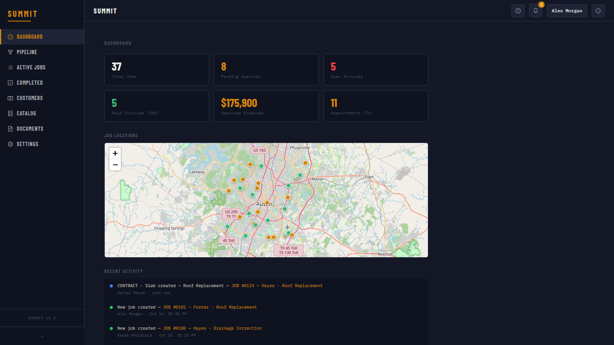
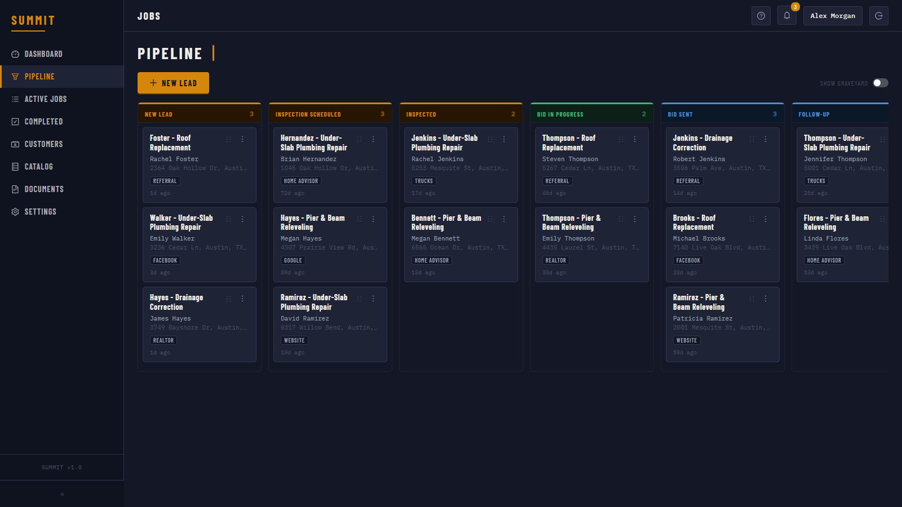
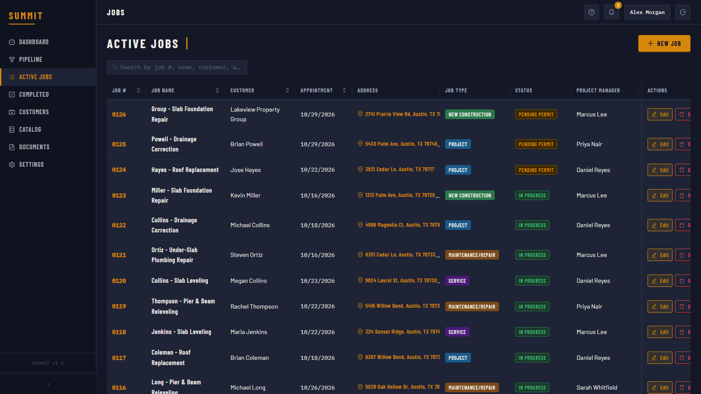
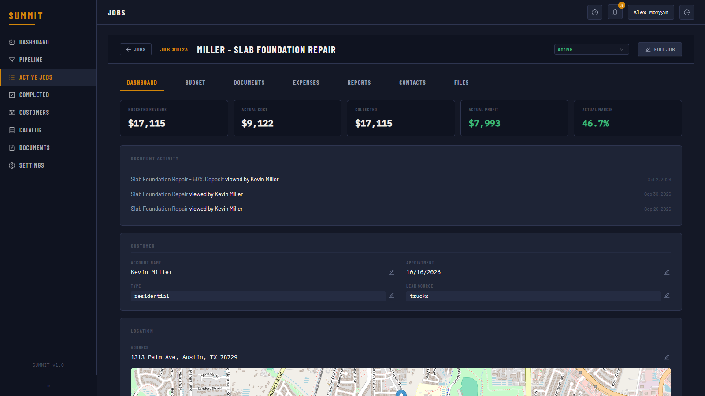
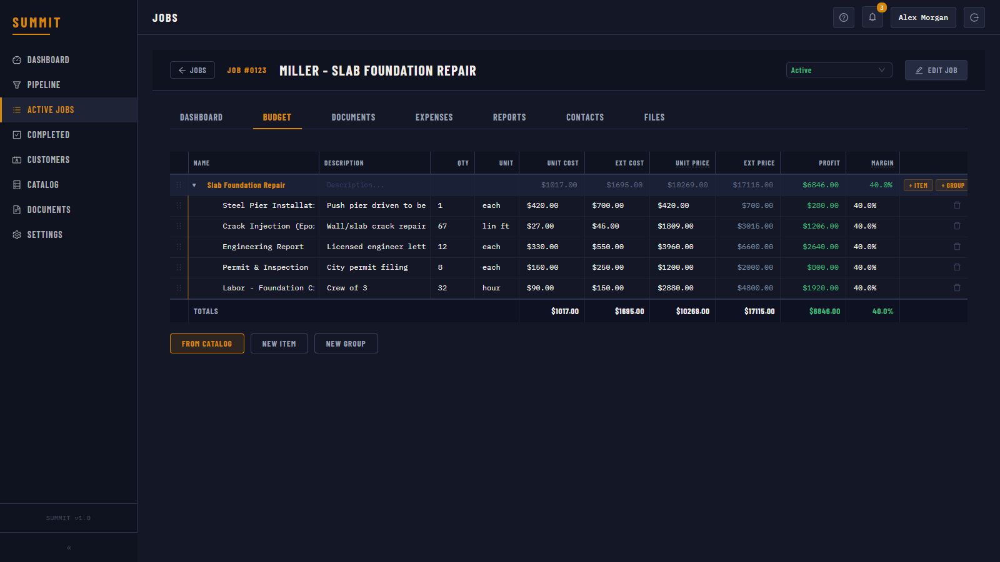
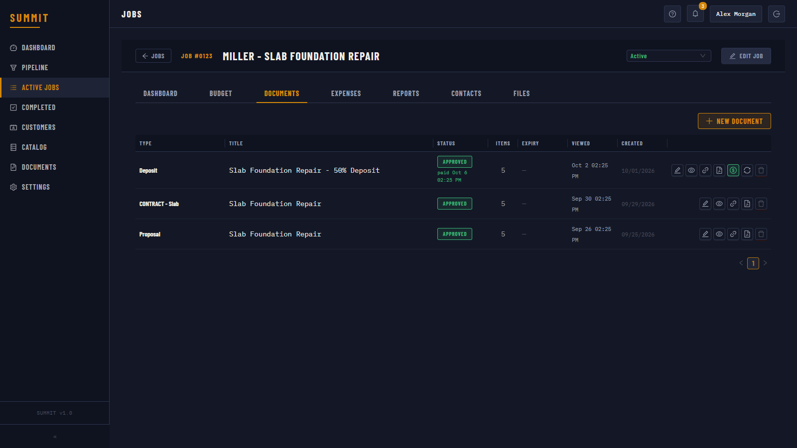
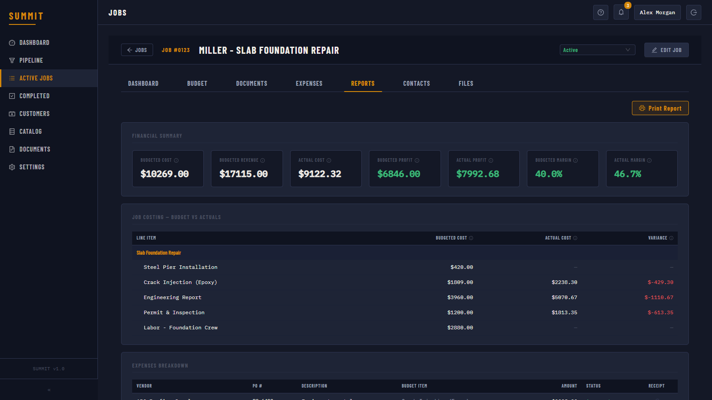
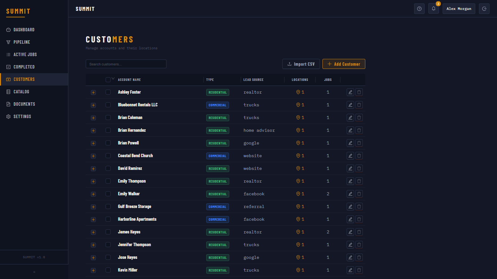
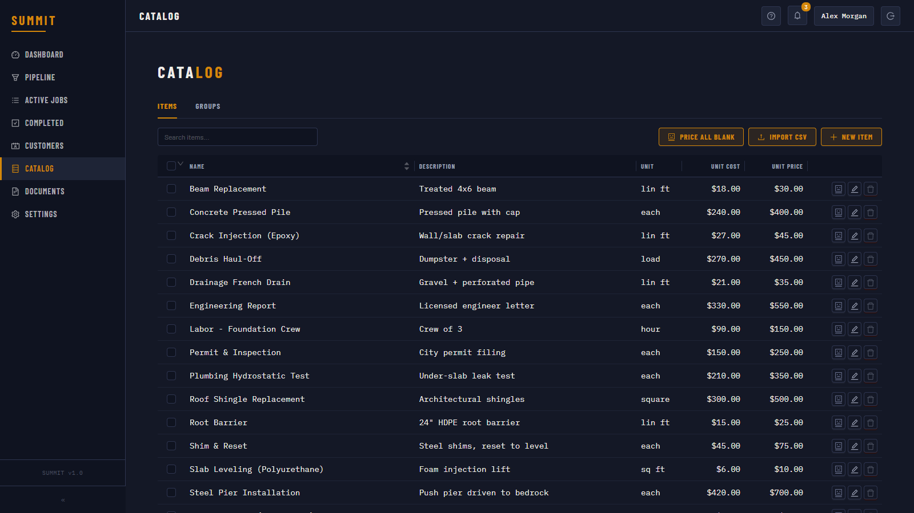
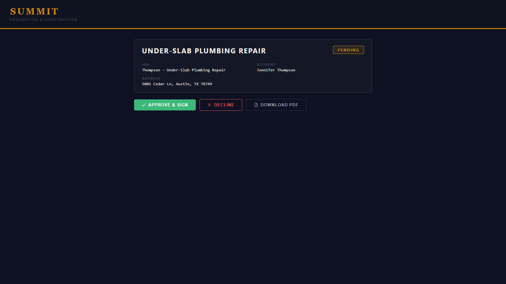

# Summit — Construction Job Manager

A full job management platform I built for a foundation & construction company, replacing their paid JobTread subscription. It covers the whole job lifecycle: leads and inspections, budgets and proposals, contracts and e-signatures, invoicing and payments, expenses and job costing.

**🔗 Live demo:** https://ibrahimahtsham.github.io/construction-job-manager/

> This repository is a **frontend-only demo**. The production app runs on a private Node.js / PostgreSQL backend for a real client, so the client's name, branding and data have been removed. In this demo every API call is answered in the browser from fake sample data, so you can click through everything. Changes are kept until you reload the page.



## Features

- **Dashboard**: KPIs (pending approvals, open and paid invoices, approved expenses, upcoming appointments), a live map of every job site, and a company-wide activity feed
- **Sales pipeline**: drag-and-drop Kanban board from *New Lead* to *Inspection* to *Bid Sent* to *Follow-Up*, which becomes an active job once won
- **Job budgets**: nested groups and line items with bidirectional cost / price / margin math (edit any field and the rest recalculate), plus a reusable item catalog
- **Documents**: proposals, contracts, change orders, deposits and progress invoices built from budget line items, with server-generated PDFs
- **Customer portal**: customers open a secure link (no login needed) to view, approve with an e-signature, or decline documents, and pay invoices online
- **Job costing**: expenses with receipts, budget vs. actual variance per line item, and actual profit and margin
- **Customers & locations**: multiple job sites per customer, encrypted gate/entry codes, contacts and file attachments
- **Integrations** (production): Microsoft SSO (Azure AD), QuickBooks invoice sync with automatic payment webhooks, and AI-assisted catalog pricing

## Screenshots

| | |
|---|---|
| **Sales pipeline**<br> | **Active jobs**<br> |
| **Job overview**<br> | **Budget with live margin math**<br> |
| **Documents & approvals**<br> | **Job costing report**<br> |
| **Customers**<br> | **Item catalog**<br> |
| **Customer portal (approve & sign)**<br> | |

## Tech stack

**Frontend (this repo):** React 18 · Vite · Ant Design (custom dark theme) · TanStack React Query · React Router · Zustand · React-Leaflet · @hello-pangea/dnd · react-signature-canvas

**Backend (private):** Node.js · Express · PostgreSQL 16 · JWT · pdfmake · QuickBooks API · Azure AD SSO · AES encryption at rest

**Deployment (production):** Linux VPS · Caddy reverse proxy with automatic TLS · systemd · automated daily PostgreSQL backups with 14-day rotation

## How the demo works

`src/demo/mockAdapter.js` is a custom [axios adapter](https://axios-http.com/docs/req_config) that answers every request from `src/demo/fixtures.json`. The fixtures are real API responses recorded from the backend running against a database of fake seed data. Writes (create, edit, delete, drag-and-drop) update an in-memory copy, so the UI behaves like the real thing. PDF buttons return a placeholder, since PDFs are generated on the server.

## Run locally

```bash
npm install
npm run dev
```

Then open the URL Vite prints (it ends in `/construction-job-manager/`).

Deploy to GitHub Pages: `npm run deploy` (builds and publishes `dist/` to the `gh-pages` branch).

---

Built by [Ibrahim Ahtsham](https://github.com/ibrahimahtsham).
